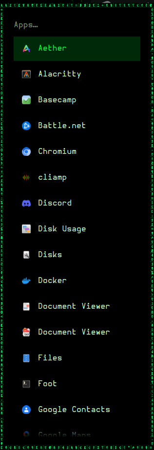
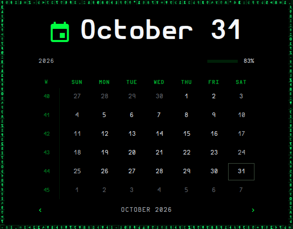
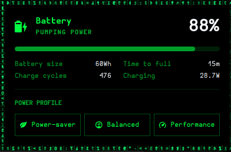
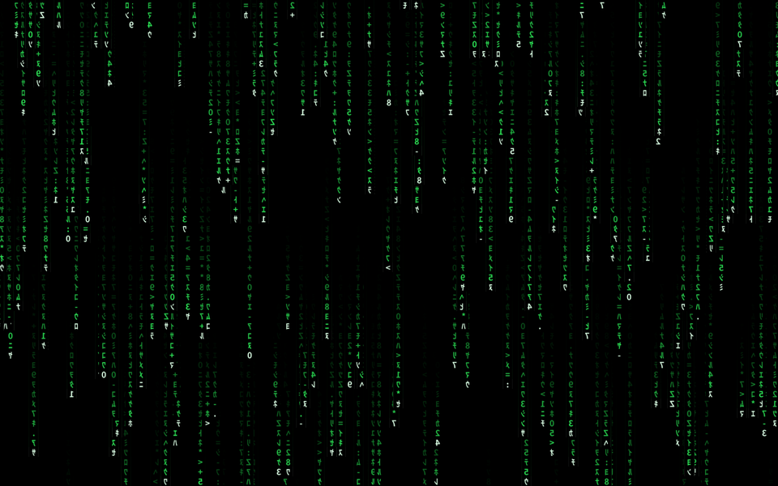

# Omarchy · Matrix

A complete "Matrix" setup for [Omarchy](https://omarchy.org) (Hyprland 0.56 with the Lua config, and the Quickshell-based omarchy-shell): the theme, a live digital-rain wallpaper and screensaver, glyph-ring window borders, decode transitions, a matrix-animated top bar and app launcher, plus fonts and a few app configs.

 





`theme/preview.png` and `theme/preview-unlock.png` are the theme previews shown in Omarchy's theme picker.

## Features

**Look**
- Phosphor green `#00ff41` on black, with the Hurmit Nerd Font everywhere (terminal, bar, launcher, monospace fallback) and soft white `#d9dde3` terminal text.
- Solid windows, square corners, no shadows.
- Gaps: 28 px between windows and 24 px at the screen edges and under the bar. A lone tiled window, or a fullscreen one, gets no gaps and no border.
- Every bar panel, tray popup and the launcher sits on solid black (`#000000`). Hover and selected rows keep a green tint. GTK 3/4 apps also get pure black backgrounds.

**Live rain wallpaper**
- A GPU-shader, movie-style Matrix rain with dense, large glyphs and white heads. Each stream drifts a little sideways and re-rolls its path on every pass.

**Glyph-ring borders**
- Hyprland's own border is hidden. Every window gets a 9 px ring of scrambling katakana in the gap outside it, never over content. Inactive rings are dim and slow; the focused ring is bright and fast and races in from the top-left.
- The same ring frames every bar panel, every tray popup and the launcher.

**Decode transitions (200 ms)**
- Opening, closing, fullscreen/floating toggles and workspace switches: windows decode out of a block of glyphs that flare white and dissolve cell by cell.
- Bar panels, tray menus and the launcher open and close with the same decode. In the launcher, entries decode in staggered, typing churns new characters in, and moving the selection plays a phosphor sweep.

**Top bar** (`plugins/sveinn.*`)
- Matrix-animated clones of the stock widgets: clock/calendar, weather, tray (and the tray-icons manager), workspaces, agents, bluetooth, network, audio, monitor and power. Live values are white and labels green.
- Each plugin has a `matrixFx` setting: `theme` (only on the matrix theme), `always` or `off`.

**Launcher** (`plugins/sveinn.menu`)
- A clone of `omarchy.menu`. Its manifest says `clonedFrom: omarchy.menu`, and `shell.json` disables `omarchy.menu`, so the shell routes every `omarchy-menu`, `omarchy-menu-select` and `omarchy-menu-input` call to it. No extra wiring is needed.

**Screensaver**
- The idle and menu screensaver is the wallpaper rain itself: fullscreen on every monitor, no text, dismissed by any key, click, scroll or mouse move. `bin/omarchy-launch-screensaver` overrides the stock launcher from `~/.local/bin` and hands off to stock on any other theme.

## Install

```sh
git clone git@github.com:zveinn/omarchy-matrix.git
cd omarchy-matrix
./install.sh --dry-run     # see what it would do
./install.sh               # install and activate
```

| Flag | Effect |
|---|---|
| *(none)* | Copy everything, then `omarchy-theme-set matrix`, `omarchy-restart-shell` and `hyprctl reload` |
| `--dry-run` | Print every action and change nothing |
| `--no-activate` | Copy files only, without switching theme or restarting anything |
| `--no-looknfeel` | Leave `~/.config/hypr/looknfeel.lua` alone (the gaps then won't match) |
| `--uninstall` | Undo the most recent install from its backup |

How it behaves:
- **No sudo, home only.** It writes only under `$HOME` and refuses anything else, including `/usr/share/omarchy`.
- **Idempotent.** Files that already match are skipped, so re-running is a no-op. Stray `*.bak*`, `*.canvas` and `*-pre-*` files in an installed copy are ignored when comparing.
- **Backups.** Anything it replaces is moved to `~/.cache/omarchy-matrix-backup/<timestamp>/files/`, and a `manifest` records what was replaced and what was new. `--uninstall` uses that manifest: it restores replaced files, deletes new ones, puts the branding links back and stops the rain. Afterwards, pick another theme with `omarchy-theme-set <name>`.
- **`shell.json`.** When `jq` is available, it merges into your existing file: it takes this setup's `bar` section (top position plus the widget layout), adds `omarchy.menu` to `disabledPlugins`, adds `sveinn.menu` to `cloneSourceRestores`, and keeps everything else (idle timers, other plugins). Without `jq` it replaces the file, with a backup.
- **Symlinked configs.** If a config such as `looknfeel.lua` is a symlink (for example into a dotfiles repo), it never writes through the link. A link that already points at identical content is left alone. Otherwise the link itself is backed up and replaced by a regular file, so the other repo is never modified, and `--uninstall` restores the link.
- **Requirements.** Needs `hyprctl`, `quickshell`, `omarchy-shell`, `omarchy-theme-set` and `omarchy-restart-shell`. It warns about optional tools (`jq`, `fc-cache`, `ghostty`). Shaders ship precompiled (`*.qsb`), so `qsb` is not needed.

## Layout

| Repo path | Installed to |
|---|---|
| `theme/` | `~/.config/omarchy/themes/matrix` (colours, `shell.toml` surfaces, `hyprland.lua` with animations, smart gaps, glyph-ring driver and transitions, backgrounds, branding, btop, icons, keyboard RGB) |
| `theme/rain/` | The Quickshell overlay process: `shell.qml` (rain + overlays), `FocusFx.qml` (glyph ring), `TransitionFx.qml` (decode effects), shaders (`*.frag` + compiled `*.qsb`), and the `matrix-rain start\|stop\|restart\|status` script |
| `theme/screensaver/` | Screensaver (`shell.qml`, `matrix-screensaver`). `rain.frag.qsb` is a relative symlink to `../rain/rain.frag.qsb` |
| `theme/src/` | Generator script and logo art (not loaded at runtime) |
| `plugins/sveinn.*` | `~/.config/omarchy/plugins/`: bar widgets and launcher. Each one is self-contained with its own `fx/` (GlyphDecode, GlyphRing, PanelRing/PanelFx or MenuFx, plus shader copies) |
| `hooks/` | `~/.config/omarchy/hooks/{theme-set.d,post-boot.d}`: starts or stops the rain on theme switch and at boot, and swaps the about/screensaver branding art |
| `bin/omarchy-launch-screensaver` | `~/.local/bin/` |
| `config/omarchy/shell.json` | `~/.config/omarchy/shell.json` (merged, see above) |
| `config/hypr/looknfeel.lua` | `~/.config/hypr/looknfeel.lua` (`gaps_in 13`, `gaps_out 23`) |
| `config/fontconfig/fonts.conf` | Makes Hurmit the default monospace font |
| `config/ghostty/config` | Ghostty with Hurmit 9 pt |
| `config/gtk-3.0`, `config/gtk-4.0` | Pure black GTK / libadwaita backgrounds |
| `fonts/HurmitNerdFont/` | `~/.local/share/fonts/` (SIL OFL 1.1, see its `LICENSE`) |
| `docs/` | Screenshots for this README |

## Handy

- Rain: `~/.config/omarchy/themes/matrix/rain/matrix-rain start|stop|restart|status`
- After editing a shader: `/usr/lib/qt6/bin/qsb --glsl "100 es,120,150" --hlsl 50 --msl 12 -o X.frag.qsb X.frag`
- After editing `theme/hyprland.lua`: run `omarchy-theme-set matrix` again.
- Weather uses Omarchy's own location setting (`omarchy-weather-location`, stored in `~/.local/state/omarchy/settings/weather.json`), so no location ships in this repo.
- Neovim is deliberately left alone: `theme/neovim.lua` just keeps a stock colorscheme (tokyonight).

## Credits

Hurmit Nerd Font: Hermit by Pablo Caro, patched by Nerd Fonts, SIL Open Font License 1.1 (`fonts/HurmitNerdFont/LICENSE`). Built on Omarchy by DHH and contributors.
